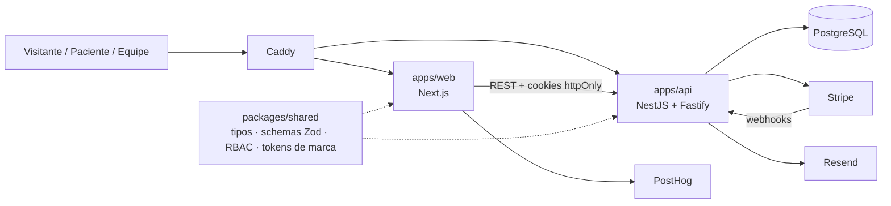

<p align="center">
  
</p>

<h1 align="center">Go Lev</h1>

<p align="center">
  Plataforma de emagrecimento com acompanhamento médico — da landing page ao portal da equipe.
</p>

<p align="center">
  
  
  
  
  
  
  
</p>

---

> [!NOTE]
> **Projeto descontinuado.** A Go Lev foi um produto de saúde construído em 2026 e que
> não seguiu adiante. O código ficou público como registro do trabalho e referência
> técnica. Ele **não recebe manutenção** e **não há nenhum ambiente no ar**.
>
> Nenhuma credencial faz parte deste repositório: todo `.env` é exemplo, e os dados de
> contato e de infraestrutura foram substituídos por placeholders. Pessoas, e-mails e
> telefones que aparecem no seed e nos testes são fictícios.

## A ideia

A Go Lev ajudava pessoas a emagrecer com **acompanhamento médico de verdade**, sem
dietas malucas e sem julgamento. O caminho era:

1. **Landing + avaliação gratuita.** Uma pré-anamnese diz se o tratamento faz sentido
   para aquela pessoa (IMC, comorbidades, histórico, objetivos).
2. **Assinatura.** Quem é elegível assina um plano mensal via Stripe; a conta do
   paciente nasce no pagamento, com o webhook como fonte da verdade.
3. **Acompanhamento.** O paciente registra peso, acompanha a evolução e as consultas;
   a equipe médica acompanha tudo pelo portal interno.

## O que tem aqui

| Área | O que faz |
|---|---|
| **Landing** (`/`) | Página de marketing com tratamentos (GLP-1), abordagem, FAQ e CTA para a avaliação |
| **Avaliação** (`/avaliacao`) | Funil de pré-anamnese em etapas, com elegibilidade e captura de lead |
| **Calculadora de IMC** | Página de ferramenta para SEO, na linguagem visual da marca |
| **Área do paciente** (`/inicio`, `/evolucao`, `/consultas`, `/plano`, `/conta`) | App mobile-first: registro de peso, gráfico de evolução, faixa de IMC, consultas, foto de perfil |
| **Portal da equipe** (`/dashboard`, `/clients`, `/appointments`…) | Dashboard, funil de avaliações, ficha clínica do paciente e agenda, com RBAC por capability (admin × médico) |
| **Billing** | Assinatura recorrente no Stripe, cupons, link de recuperação de checkout, retenção de payload de webhook (LGPD) |
| **E-mails** | Transacionais via Resend (boas-vindas, definição e redefinição de senha) |
| **Marca** (`brand/`) | Design system: essência, tom de voz, cores, tipografia, logo e carrosséis de conteúdo |

## Stack

| Camada | Tecnologia |
|---|---|
| Frontend | Next.js 15 (App Router) · Tailwind CSS v4 · shadcn/ui · Framer Motion · TanStack Query · Zustand |
| Backend | NestJS 11 + Fastify |
| Banco | PostgreSQL · Drizzle ORM · postgres.js |
| Auth | JWT (access + refresh) em cookies httpOnly · argon2 |
| Pagamentos | Stripe (Checkout + webhooks) |
| E-mail | Resend |
| Analytics | PostHog |
| Monorepo | pnpm workspaces · Turborepo |
| Qualidade | Vitest · Playwright · ESLint (typescript-eslint) · Husky + lint-staged |
| Infra | Docker · Caddy · GitHub Actions (runner self-hosted) · Infisical para segredos |

## Arquitetura



```
├── apps/
│   ├── web/          # Next.js — landing, avaliação, área do paciente e portal
│   └── api/          # NestJS — auth, anamnese, pacientes, consultas, billing, e-mail
├── packages/
│   └── shared/       # Contratos, schemas Zod, RBAC e design tokens
├── brand/            # Design system e conteúdo da marca
├── infra/            # Dockerfiles, Caddy, docker-compose (dev, prod, preview)
├── e2e/              # Testes E2E (Playwright)
├── scripts/          # Setup de VPS, deploy, túnel para o banco
└── .ai/              # Regras, skills e contexto para agentes de IA
```

A arquitetura completa está em [`golev-architecture.md`](./golev-architecture.md).

## Rodando localmente

Requisitos: Node 24+, pnpm 10 e Docker.

```bash
pnpm install
cp .env.example .env

# Postgres
docker compose -f infra/docker-compose.yml --project-directory . up db -d

# migrations + dados fictícios
pnpm --filter @golev/api db:migrate
pnpm --filter @golev/api db:seed

pnpm dev
```

- Web: http://localhost:3000
- API: http://localhost:3333

O pagamento fica desligado por padrão (`BILLING_ENABLED`). Para testar o Stripe, use
chaves de **modo teste** no seu `.env`.

| Comando | Descrição |
|---|---|
| `pnpm dev` | Sobe web e API em modo dev |
| `pnpm build` | Build de tudo |
| `pnpm lint` · `pnpm typecheck` | Lint e checagem de tipos |
| `pnpm test:unit` · `pnpm test:e2e` | Testes unitários e E2E |
| `pnpm --filter @golev/api db:generate` | Gera uma migration |
| `pnpm --filter @golev/api db:studio` | Abre o Drizzle Studio |

## Algumas decisões que valem a leitura

- **Conta nasce no pagamento.** Não existe cadastro aberto: o webhook do Stripe cria o
  paciente e dispara o e-mail de definição de senha.
- **RBAC por capability**, não por papel: "atende consultas" (`is_doctor`) é separado do
  nível de acesso, e as permissões vivem em `packages/shared`.
- **CSP híbrida:** nonce por requisição nas rotas logadas e política compatível com
  estático no marketing.
- **Tokens em cookies httpOnly**, fora do alcance de XSS.
- **Preview por PR:** a label `preview` sobe um ambiente efêmero na VPS.
- **Design tokens únicos** em `packages/shared/brand/tokens.css`, consumidos pelo app e
  pelos HTMLs de marca.

## Convenções

- **Branches:** `feat/`, `fix/`, `chore/`, `refactor/`, `hotfix/`
- **Commits:** Conventional Commits (`feat(billing): add stripe webhooks`)
- **PRs:** squash merge, com template

## Licença

[MIT](./LICENSE). Use, copie e adapte à vontade. O nome e a marca Go Lev ficam como
referência do projeto original.

---

<p align="center"><sub>Go Lev · 2026 · projeto encerrado</sub></p>
