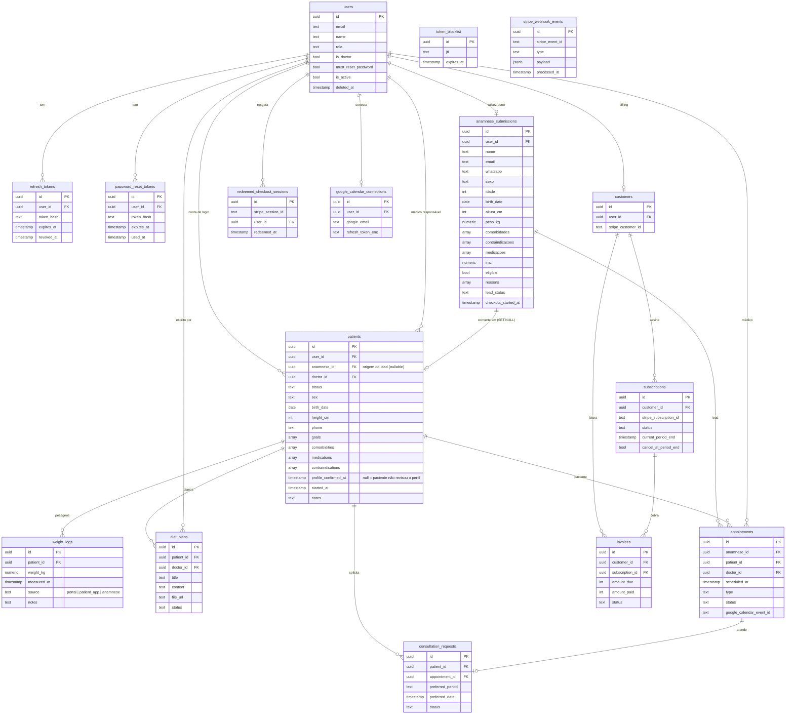
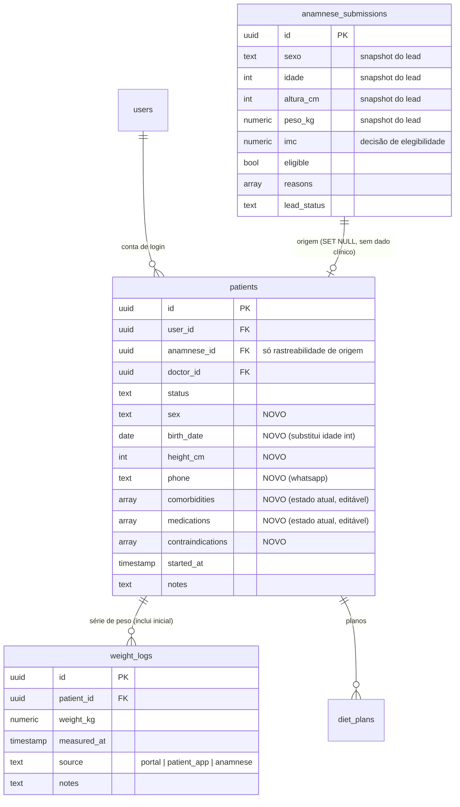

# Schema do banco — Go Lev

> **Diagrama vivo do banco.** A fonte da verdade são os schemas Drizzle em
> [`apps/api/drizzle/schema/`](./schema). **Sempre que mudar o schema, atualize
> este arquivo** — ele é a visão de "como o banco está hoje".
>
> Os diagramas são [Mermaid](https://mermaid.js.org/) `erDiagram` — renderizam
> direto no GitHub e no preview de Markdown do VS Code. Cardinalidade:
> `||--o{` = um-para-muitos, `||--o|` = um-para-zero/um.

---

## Visão geral (estado atual)

### Domínios

| Domínio | Tabelas |
|---|---|
| **Auth** | `users`, `refresh_tokens`, `password_reset_tokens`, `token_blocklist` |
| **Lead** | `anamnese_submissions` |
| **Paciente** | `patients`, `weight_logs`, `diet_plans` |
| **Consultas** | `appointments`, `consultation_requests` |
| **Billing** | `customers`, `subscriptions`, `invoices`, `stripe_webhook_events`, `redeemed_checkout_sessions` |
| **Integrações** | `google_calendar_connections` |

---

## Refatoração do perfil clínico — APLICADA (2026-06-21)

**Status:** ✅ aplicada na migration `0011_dazzling_randall`. O diagrama de
"Visão geral" acima já reflete o estado novo. Esta seção fica como registro da
decisão e do que mudou.

### Problema (resolvido)

O perfil clínico e demográfico do paciente (sexo, idade, altura, peso inicial,
comorbidades, medicações, whatsapp, IMC) só existe em `anamnese_submissions` —
a tabela de **captação de lead**. A `patients` não tem nenhuma coluna clínica;
ela lê tudo via join no lead (`patients.anamnese_id`).

Como esse vínculo é `ON DELETE SET NULL` e o lead é, por design, purgável
(LGPD), **purgar um lead apaga o perfil clínico do paciente** — a tela de
evolução zera (altura/peso inicial/IMC viram `null`). É uma inversão de ciclo
de vida: a tabela mais efêmera é dona dos dados mais permanentes.

Lido em dois pontos hoje:
- `apps/api/src/modules/me/me.service.ts` (app do cliente) — altura, peso
  inicial e IMC vêm de `patient.anamnese`.
- `apps/api/src/modules/patients/patients.service.ts` (portal da equipe) —
  `findAll`/`findOne` puxam `imc, peso_kg, altura_cm, idade, sexo, comorbidades,
  whatsapp` da anamnese.

### Alvo

`patients` ganha perfil próprio; `weight_logs` vira a **única** série de peso (o
peso da anamnese entra como primeiro registro `source = 'anamnese'`);
`anamnese_submissions` fica como **snapshot imutável** de captação +
elegibilidade, e passa a ser seguro purgar.

### Lógica da migração

1. **Schema** (`patients`): `ADD COLUMN` `sex`, `birth_date`, `height_cm`,
   `phone` (nullable) e `comorbidities`, `medications`, `contraindications`
   (`text[]` default `'{}'`).
2. **Backfill perfil**: `UPDATE patients p SET sex=a.sexo, height_cm=a.altura_cm,
   phone=a.whatsapp, comorbidities=a.comorbidades, medications=a.medicacoes,
   contraindications=a.contraindicacoes FROM anamnese_submissions a WHERE
   p.anamnese_id = a.id`. `birth_date` é aproximado do ano (`idade` é lossy) ou
   deixado `null` p/ a equipe completar.
3. **Backfill peso inicial → `weight_logs`**: `INSERT ... SELECT p.id, a.peso_kg,
   COALESCE(a.consent_at, a.created_at), 'anamnese' ... WHERE NOT EXISTS (log
   source='anamnese')`. Idempotente.
4. **Conversão** (`patients.service.ts` `provisionPatientAccount`): ao criar o
   `patient`, popular as novas colunas do lead e inserir o `weight_log` inicial
   (`source='anamnese'`) na mesma transação.
5. **Leitura app cliente** (`me.service.ts`): altura/IMC vêm de
   `patient.height_cm`; peso inicial vem do 1º `weight_log`. Para de depender de
   `patient.anamnese`.
6. **Leitura portal** (`patients.service.ts` `findAll`/`findOne`): ler as colunas
   de `patients`; manter `anamnese` só para origem/auditoria.
7. **Shared**: `WeightLogSource` ganha `ANAMNESE = 'anamnese'`; novo enum `Sex`;
   schemas Zod de edição de perfil pela equipe.

### O que ficou pra depois (dívida conhecida)

- ✅ **Portal lê o perfil de `patients`** (`patients.service` `findAll`/`findOne`):
  telefone, altura, idade, objetivos e comorbidades vêm do perfil vivo; só o IMC
  da avaliação inicial segue da `anamnese` (snapshot). Fecha a divergência com o
  card — paciente edita o perfil e o portal reflete na hora.
- **`birth_date`**: leads novos vêm com a data exata — o funil de anamnese
  coleta data de nascimento → `anamnese_submissions.birth_date` → conversão usa
  direto. Leads antigos (sem ela) têm a data aproximada do ano (derivada de
  `idade`), mitigada pelo card de confirmação no `/inicio`
  (`profile_confirmed_at`). `idade` na anamnese passou a ser derivada.

---

## Como manter este diagrama confiável

- **Fonte da verdade:** os schemas Drizzle em [`schema/`](./schema). Este `.md` é
  derivado — atualize no mesmo PR que mexer no schema.
- **Inspeção do banco ao vivo:** `pnpm --filter @golev/api db:studio` abre o
  Drizzle Studio (navega tabelas e linhas reais) pra conferir o banco contra este
  diagrama.
- **Migrations:** `db:generate` (gera SQL) → `db:migrate` (aplica). ⚠️ O banco de
  **dev** local tem histórico de migrations dessincronizado (squashes antigos);
  se `db:migrate` reclamar de "relation already exists", aplique a migration nova
  via `psql` e registre o hash em `drizzle.__drizzle_migrations`. Produção tem o
  histórico limpo.
